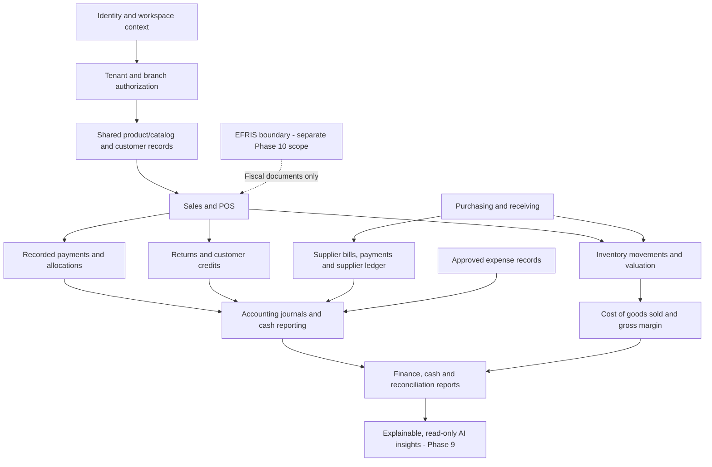

# LEXA — Revised Phase 8–12 Architecture & Implementation Plan

**Revision:** 2.0 — consolidated planning edition  
**Date:** 22 October 2026  
**Status:** Planning decision for discussion before implementation  
**Basis:** Phase 7 closeout ZIP, Phase 8–12 handoff, replan status board, current source inspection, and the agreed payment-recording boundary  
**Purpose:** Give the next implementation session one source of truth for the architecture, module connections, implementation order, and rules for avoiding repeated production-readiness work.

---

## 1. Decisions to carry forward

### 1.1 Product direction

LEXA is a business operating system for Ugandan retail SMEs. Its core jobs are to help a business sell, keep reliable stock, manage purchasing and supplier obligations, track customer credit, record money received and spent, understand financial results, and make better operational decisions.

The product should feel like one connected system, not a set of screens that maintain separate versions of the same facts.

### 1.2 Payment-recording boundary — non-negotiable

**LEXA records how the business says it received money. LEXA does not process, transfer, collect, settle, or independently verify payments.**

Examples of owner-configured payment methods:

- `Cash`
- `MTN Line 1`
- `MTN Line 2`
- `Airtel Line 1`
- `Stanbic`
- `Centenary Bank`
- `Card`, `Cheque`, and `Other` where relevant

The business owner creates a friendly label and chooses a category and currency. Staff select that method when recording a payment. They may add an ordinary transaction/slip reference, if useful.

LEXA must not provide payment-gateway setup, wallet connection, payment initiation, disbursement, automated settlement, payment-status polling, provider callback handling, or payment-provider credential storage. Do not collect or store mobile-money PINs, OTPs, bank passwords, gateway API keys, access tokens, provider login details, or webhook secrets. Do not put secrets in metadata, notes, transaction references, environment variables, or generic configuration fields for the purpose of processing payments.

A payment recorded by a member of staff is a **recorded payment**, not a provider-verified payment. The product must never present it as bank-confirmed or mobile-money-confirmed unless a separately approved future requirement changes the product boundary. That is not in this roadmap.

### 1.3 EFRIS is a separate compliance concern

EFRIS concerns fiscal invoicing/receipting and sharing the relevant transaction information with URA; it is not a payment gateway. Keep EFRIS in a separate, explicitly scoped integration boundary.

Do not ask users to paste a URA portal password or one-time code into generic LEXA settings. Any future system-to-system EFRIS authentication design must be researched, scoped, and approved separately; it must not be bundled into the no-payment-gateway decision or Phase 8 finance work.

### 1.4 Phase order for this revised plan

The user's latest direction overrides the older roadmap order:

1. **Phase 8 — Finance and cross-module correctness/polish**
2. **Phase 9 — Explainable, read-only business intelligence and AI integration**
3. **Phase 10 — EFRIS assessment/integration and practical operational hardware needs**; no payment gateway integrations
4. **Phase 11 — Multi-branch/customer-growth improvements and remaining operating workflows**
5. **Phase 12 — One consolidated pre-production, launch-readiness and production-approval gate**

Some tenant, permission, date, currency, data-quality, and record-traceability prerequisites must be checked in the feature that uses them. Full release-wide certification still belongs to Phase 12.

### 1.5 Production gate policy

**Phases 8–11 are product-building phases. Phase 12 is the single shared release gate.**

Do not require paid staging infrastructure, production migrations, a production deployment, a full hosted end-to-end run, a backup/restore drill, or a repeated full release audit before implementing the next product slice.

Still run appropriate tests when a feature changes. Do not defer correctness, tenant/branch authorization, financial and stock invariants, auditability, idempotency, or feature-level regression tests. Defer only the expensive, release-wide checks that should be run against one frozen candidate.

### 1.6 No production changes during Phases 8–11

Use the agreed Phase 7 source candidate and a disposable/isolated development database. Do not apply candidate migrations to production. Do not enable live fiscal submissions or live external integrations in the feature-building phases. Do not create paid resources without explicit approval at the Phase 12 cost decision.

---

## 2. What the current evidence establishes

The supplied Phase 7 and replanning documents describe a substantial implementation candidate, including supplier terms/prices, purchase orders, partial receiving, landed costs, returns/credits, supplier bills, supplier payments/allocations and a supplier ledger. The supplied handoff reports backend/frontend test evidence and a manual disposable PostgreSQL replay, while expressly keeping production release status as **NO-GO / not release-accepted**.

Source inspection also found existing structures for:

- Tenant/workspace membership, roles, permissions, branch assignments and row-level security.
- Products/variants, catalog prices, sales, sale returns and payment channels.
- Payments, payment allocations, customer receivables and customer-credit allocations.
- Daily reconciliation headers and per-payment-channel reconciliation lines.
- Inventory balances, movement records, transfers, adjustments, valuation and replenishment/ageing analysis.
- Purchase orders/receipts, landed costs, purchase returns, supplier bills/payments/allocations and supplier ledger.
- Accounting accounts/periods, journal entries/lines, expenses and financial statements.
- Analytics aggregates and an early `brain_*` foundation.
- An EFRIS configuration/fiscal-document foundation, which must not be confused with an implemented or certified live EFRIS integration.

The public repository source was also inspected for payment channel creation/listing, sales/payment allocation, customer receivable payment, and manual daily reconciliation. The repository's `main` and the Phase 7 source ZIP are not to be presumed identical: the handoff says some source fixes are not yet published to GitHub/hosted deployments. At the start of implementation, treat the **exact Phase 7 candidate ZIP/source handed over for development** as the code baseline and verify the small set of files relevant to the slice. Do not reopen unrelated historical recovery or release investigations without new evidence.

References for source orientation:

- [LEXA commerce routes](https://github.com/MONALISA2003-CMD/LEXA-/blob/main/apps/api/app/routes/commerce.py) — design/source orientation; verify candidate parity before editing.
- [LEXA accounting/finance routes](https://github.com/MONALISA2003-CMD/LEXA-/blob/main/apps/api/app/routes/finance.py) — design/source orientation; verify candidate parity before editing.
- [Payment and reconciliation schema migration](https://github.com/MONALISA2003-CMD/LEXA-/blob/main/migrations/016_phase4a_sales_payments_reconciliation.sql) — existing data-model reference.
- [Reconciliation calculation migration](https://github.com/MONALISA2003-CMD/LEXA-/blob/main/migrations/017_phase4a_reconciliation_engine.sql) — existing manual reconciliation reference.
- [Customer-credit allocation migration](https://github.com/MONALISA2003-CMD/LEXA-/blob/main/migrations/019_phase4a_customer_credit_allocation.sql) — existing receivable/credit allocation reference.
- [Accounting and EFRIS foundation migration](https://github.com/MONALISA2003-CMD/LEXA-/blob/main/migrations/020_phase4b_accounting_efris_foundation.sql) — existing accounting/fiscal data-model reference.

These references are orientation, not evidence that the currently deployed application exactly matches the ZIP or that production gates passed.

---

## 3. Target architecture

### 3.1 Architectural rule

Keep the existing modular API/database architecture. Prefer the smallest complete vertical slice across UI, API/service, source records, permission checks, audit/status behavior and tests. Do not start a broad rewrite or introduce a duplicate ledger just to simplify a new screen.

The diagram shows logical ownership and flow; it does not prescribe a new microservice architecture. Keep the existing service boundaries unless a concrete implementation need justifies a change.

### 3.2 Source-of-truth ownership

| Business fact | Authoritative source | Modules that consume it | Must not happen |
|---|---|---|---|
| Product identity, variant, SKU, unit and configured selling price | Existing catalog/product structures | Sales, inventory, purchasing, reporting and AI | A second product or price ledger per module |
| Sale and sale lines | Existing completed-sale records | Payments, receivables, returns, inventory, accounting and reports | Reporting from a UI-only total or draft sale |
| Payment received as entered by staff | `payments` and associated payment allocations/status | Sale settlement, receivables, cash reports, reconciliation and accounting | Calling a recorded entry provider-verified; copying totals to separate ledgers |
| Available customer credit / outstanding receivable | Existing receivables and payment/credit allocations | Customer history, reports, AI insights | Independent balance calculations that drift from allocations |
| Stock on hand and stock movement | Existing inventory balance and movement ledger | POS availability, purchasing, stock health, COGS and AI | Direct balance edits that bypass movement/audit rules |
| Supplier obligations | Phase 7 supplier bills, allocations, payments and supplier ledger | Payables, cash planning, accounting and reporting | Creating a second supplier-balance ledger |
| Posted expense | Existing expense record and linked accounting entry as the workflow requires | Cash reporting, profit reporting and accounting | Counting draft/voided/unposted expense as posted cash/profit |
| Accounting balance | Posted journal entries/lines and approved report functions | Trial balance, income statement, balance sheet and finance reports | Replacing accounting outputs with manually maintained dashboard numbers |
| Payment-channel label and type | Tenant-owned `payment_channels` | Sales, expenses, reconciliation and reports | Treating a channel as a live integration or storing credentials in it |
| EFRIS document status | Separate fiscal-document/EFRIS boundary, once implemented | Fiscal document and compliance views | Inferring fiscal acceptance from sale completion or payment recording |
| AI insight | Derived from approved, authorized, defined source queries/metrics | Owner/manager insight UI | Treating generated prose as the source of truth or mutating business records automatically |

### 3.3 Cross-cutting contracts every module must share

1. **Tenant and permission scope:** all reads, writes, reports, drill-throughs and AI evidence are scoped to the authenticated user's tenant and authorized business/branch context. Frontend hiding is not an authorization control.
2. **Business date and time:** operational/reporting dates use the established tenant business-calendar rules where applicable, not an arbitrary host timezone assumption.
3. **Currency:** records and sums stay currency-aware. Do not add values from different currencies without an explicit, documented conversion rule. UGX is the default only where the business profile/configuration dictates it.
4. **Status semantics:** distinguish draft, recorded, posted, voided, reversed, pending, accepted and other domain states where appropriate. Each report documents which states it includes/excludes.
5. **Auditability:** sensitive finance, stock, approval, role and configuration actions retain actor, timestamp, reason/reference and source linkage where applicable. Corrections should be traceable reversals/adjustments rather than silent destruction.
6. **Idempotency:** safely repeated client requests cannot duplicate sales, recorded payments, allocations, inventory movements, journals or other consequential records.
7. **Drill-through:** a material KPI or balance leads to authorized supporting records. Missing or stale sources render as `Unavailable`, `No records`, or a clear error—not as a fabricated zero.
8. **Small-slice quality:** changed features receive targeted tests for their own logic, invariants and permissions. Release-wide checks are not repeated on every increment.

---

## 4. Module map and pre-AI polish requirements

### 4.1 Identity, workspace, branch context and permissions

**Existing foundation:** auth/session, tenant membership, roles/permissions, branch assignments, workspace context and database RLS are represented in the candidate.

**Polish before AI:**
- Ensure the active workspace/business context is clear and stable across navigation.
- Make the selected branch/context visible on applicable screens and reports.
- Ensure API/database authorization guards both detail records and aggregated reports.
- Give permission-denied states a clear message rather than a misleading empty result.
- Test positive and negative authorization paths for any changed workflow.

Do not use this as a reason to build an oversized enterprise branch administration system in Phase 8. Complete minimum safe scoping for current work and schedule broader branch/customer workflows for Phase 11.

### 4.2 Products and catalog

**Existing foundation:** product/variant, category, barcode, price and related catalog structures.

**Polish:** keep one shared product identity across POS, inventory, purchase orders/receipts, returns and reports. Validate selling-price overrides and discounts through existing permissions. Use consistent names, units, and availability messages on phone-sized screens. Do not redo the catalog just for visual consistency if the current workflow is already usable.

### 4.3 Sales, POS, returns and customer history

**Existing foundation:** completed sales/lines, sale-return lines, refunds, payment allocations and accounting/inventory posting hooks.

**Polish:**
- Keep sale amount, amount recorded as paid and amount due as separate facts.
- Support multiple recorded payment methods against one sale.
- Maintain return/refund/credit and accounting consistency.
- Keep payment recording linked to the sale and actor, with an optional ordinary reference.
- Provide customer history across sales, returns, recorded payments, issued/allocated credits and receivable balance when the customer journey is improved.
- Do not permit an ordinary checkout to silently over-allocate payments beyond the sale amount; document and test any intentionally supported exception separately.

### 4.4 Inventory and stock intelligence

**Existing foundation:** stock balance, movement ledger, adjustments, stocktakes/transfer structures, valuation, ageing/movement health and replenishment suggestions.

**Polish:** every stock-impacting workflow must use the existing inventory movement rules: sales, returns, purchase receiving, supplier returns, approved adjustments and transfers. Stock displayed in POS and reports must align with inventory records. Cost/valuation policy must be defined before deriving COGS or margin. Replenishment suggestions remain advisory and do not create orders automatically.

### 4.5 Purchasing and suppliers

**Existing foundation from Phase 7:** supplier pricing/terms, purchase orders, partial receiving, landed costs, returns/credits, supplier bills, payments/allocations and supplier ledger.

**Polish:** ensure the receipt and landed-cost workflow updates inventory and cost inputs consistently; supplier bills and payments reconcile to the existing supplier ledger; supplier credits/returns affect the correct payable; and reports drill through to actual source records. Reuse Phase 7 rather than introducing duplicate supplier balances or duplicated purchase receipt logic.

### 4.6 Finance and accounting

**Existing foundation:** customer receivables/credit allocations, payment-channel and payment records, manual daily reconciliation, accounting accounts/periods, journal entries/lines, posting/reversal functions, expenses and financial statement functions.

**Polish in Phase 8:** finish the user-facing workflows and any missing contracts around customer balances, supplier payables, expense posting, cash movement, reconciliation and profitability reporting. Finance should read existing transactional/ledger records and approved accounting functions rather than invent balances for dashboards.

### 4.7 Reports and analytics

**Existing foundation:** dashboard/report pages, analytics aggregates and stock-health/replenishment views.

**Polish:** use one metric contract per displayed KPI. Each metric needs a definition, formula, source, currency rule, business-date basis, period/filter behavior, return/void/status treatment, permissions, refresh/freshness behavior, empty/error state and a reconciliation example/test. Clearly label collections separately from sales/revenue; gross margin separately from net profit; and recorded payments separately from manually reconciled actual amounts.

### 4.8 Customer experience and cross-module UX

The objective is coherence, not a broad redesign. Improve the workflow when a user encounters a real inconsistency: inconsistent status labels, unclear business/branch context, dead or misleading actions, missing confirmation/error feedback, confusing empty states, or no useful way back to the source transaction. Reuse existing UI components and patterns.

### 4.9 Early AI foundation

The candidate contains an early `brain_*` database foundation and existing rule-based inventory suggestions. This does not establish that a generic AI assistant is ready.

Before adding AI, ensure the relevant source metrics and permissions are trustworthy. Phase 9 should begin with read-only, bounded, explainable insights—not unrestricted access to arbitrary SQL or autonomous record mutation.

---

## 5. Payment-channel and manual-recording design

### 5.1 Owner setup

Payment-method settings should allow an authorized owner/finance manager to:

- Create a method with a friendly name, category, and currency.
- Optionally specify a non-secret provider/institution label for sorting/filtering.
- Edit the display name/category/provider label only within rules that do not invalidate historical meaning.
- Deactivate a method for future selection without deleting old payments or their method labels.
- See which methods are active and which are retained only for history.

The owner must be able to create two methods of the same type, for example `MTN Line 1` and `MTN Line 2`, and several banks with distinguishable names. Do not make a phone number or bank account number mandatory: a user-defined label is sufficient. If a future request calls for identifiers, separately review data-minimization and privacy before adding any field.

### 5.2 Existing model to reuse

The inspected source has a tenant-scoped `payment_channels` structure with a label (`name`), type (`channel_type`), optional `provider`, currency, and active state. The payment entry has a channel ID and optional reference; the payment is allocated to a sale or receivable. Reuse these structures if the exact Phase 7 candidate matches them. Do not add a second payment method catalogue or wallet/account integration model.

Allowed recorded channel categories in the inspected code are `CASH`, `MOBILE_MONEY`, `BANK`, `CARD`, `CHEQUE`, and `OTHER`. “Credit” is not a payment channel: it is an outstanding receivable until recorded payment or approved credit allocation settles it.

### 5.3 Recording a sale payment

For a sale, staff select one or more configured payment methods and enter each amount. LEXA should:

1. Validate that each selected method belongs to the active tenant, is active for new use, and has a matching currency.
2. Validate the total allocation under the defined checkout rules; keep any due balance as a receivable rather than pretending it was collected.
3. Store payment and allocations, the business date, actor/audit trace and optional ordinary transaction/slip reference.
4. Update sale paid/due totals through existing approved logic.
5. Create or link required accounting journal records using the current accounting contract.
6. Ensure retries cannot duplicate the payment or its accounting/stock effects.
7. Display a truthful status such as `Recorded` and never `Provider verified`.

For later customer payments, allocate the payment to the relevant receivable and maintain the existing remaining balance. Over-allocation, cross-customer allocation and currency mismatch must be rejected.

### 5.4 Manual daily reconciliation

For each business date and configured channel, LEXA calculates expected receipts from recorded transactions using the source status/return rules. An authorized owner/manager then enters the actual amount they determined from their own cash count, mobile-money statement, bank statement or other records. LEXA calculates variance and records notes, reviewer and resolution status.

Use careful labels:

- **Recorded by LEXA** — payments entered into the application.
- **Actual amount entered** — a human-supplied reconciliation figure.
- **Difference / variance** — actual amount minus the defined expected amount.
- **Reviewed / resolved** — a user completed the configured review workflow.

Never call reconciliation “bank verified” or “MTN confirmed.” LEXA does not have the provider connection required to make those claims.

### 5.5 Expense payment method

An expense may use one configured payment method when the expense was actually paid from that channel, subject to the existing expense/accounting workflow. An unpaid supplier expense/payable must not be misrepresented as a cash outflow. Draft, posted, voided and reversed treatment must be explicit and consistent across cash reports and accounting.

### 5.6 Credential and secret protections

- Do not build payment gateway configuration pages or integration code.
- Do not request, receive, store, log, export or pass through wallet PINs, OTPs, bank credentials, gateway secrets, access tokens or webhook secrets.
- Ensure free-text fields/references are not used as secret stores; add basic UI guidance such as “Do not enter PINs, passwords or security codes.”
- Do not store the full card PAN or CVV as part of payment notes or references.
- Do not transmit recorded customer/payment data to AI providers by default. Any future AI data-sharing contract must be separately scoped, data-minimized and permission-aware.

---

## 6. Phase 8 — Finance and profitability

### Outcome

A business owner/bookkeeper can follow money owed, money recorded as received, supplier obligations, expenses and cash movement from summaries down to source transactions, and can understand each figure's meaning.

### Implementation order

#### Slice 8A — Receivables/payables contracts and reconciliation fixtures

Start with source-of-truth notes rather than a dashboard redesign.

- Inspect the agreed candidate's sale, return, customer payment/credit, receivable, supplier bill, supplier payment/allocation and supplier ledger logic.
- Document customer receivable calculation, supplier payable calculation, payment statuses, credit/return treatment and reversal behavior.
- Add/repair fixed fixtures for: credit sale; full and partial customer payment; return/approved credit; supplier bill; partial supplier payment; supplier credit/return; void/reversal; invalid and over-allocation.
- Prove totals equal the authoritative source records.

#### Slice 8B — Payment channels and payment recording

- Finish owner management of method creation, editing and deactivation (preserving history).
- Verify cash, two separate MTN labels, Airtel label, named banks and `Other` all work as independent methods.
- Verify split payments, optional references, currency checks, active/inactive method handling and actual due-balance calculation.
- Verify no gateway initiation, provider callbacks, credential fields or provider-verification claim exists.

#### Slice 8C — Expense lifecycle

- Capture expense date, category/account, amount/currency, payment method if paid, status, reference/description and responsible actor.
- Make draft, posted, voided and reversed behavior explicit and traceable under the chosen current model.
- Ensure only the correct posted states feed cash movement and profit/accounting reports.
- Keep unpaid supplier obligations separate from cash already paid.

#### Slice 8D — Cash movement and manual reconciliation

- Show recorded inflows/outflows by business date and channel, with source links.
- Enable manual actual-amount entry and variance review by authorized roles.
- Specify treatment of refunds, voids, reversals, expenses, customer receivable payments and currency.
- Keep actual amounts entered by users separate from amounts calculated from LEXA records.

#### Slice 8E — Finance reports and mobile drill-through

Define and test at least:

- Completed/net sales under the approved return rules.
- Payments recorded/collections, by their documented business-date basis.
- Outstanding customer receivables and overdue balances.
- Supplier bills/payables outstanding from the Phase 7 ledger.
- Posted expenses.
- Net cash movement with included inflows/outflows stated.
- Cost of goods sold (COGS), gross margin value/rate where the cost policy supports it.

Gross margin is not net profit. Revenue/sales and cash collection are not the same. A record that cannot be verified must not quietly show as zero.

### Phase 8 acceptance criteria

- Receivable totals reconcile after credit sale, partial/full payment, return/credit and reversal.
- Supplier balances reconcile to Phase 7 bill/payment/allocation/ledger records; no second supplier ledger exists.
- Split payments and later receivable payments work; invalid/cross-customer/currency-mismatched and over-allocations are rejected.
- Repeated requests cannot create duplicate payments, allocations or accounting entries.
- Configured channels are tenant-scoped; deactivation preserves historical traceability.
- Reports distinguish completed sales, recorded collections, actual reconciliation inputs, outstanding credit, payables, posted expenses, COGS and gross margin.
- Refunds, returns, voids and reversals are included/excluded consistently by the metric contract.
- Branch/tenant access for changed APIs and reports is tested, including denied access.
- Phone-sized flows show clear loading, empty, success, validation, error and permission-denied states where relevant.
- Only the relevant backend/frontend checks run; schema changes are exercised on a disposable database.
- No treated critical correctness/security defect remains open in the slice.

### Phase 8 non-goals

- No payment gateways or provider integrations.
- No AI-generated financial advice or forecasting.
- No new supplier/customer balance ledgers.
- No production migration or deployment.
- No full release audit, paid staging provisioning, or recovery drill as a prerequisite.

**Exit:** Phase 8 is `IMPLEMENTED — LOCAL ACCEPTANCE` when its in-scope workflows and targeted tests pass. It is not `PRODUCTION ACCEPTED`.

---

## 7. Phase 9 — Explainable, read-only business intelligence and AI

### Outcome

Owners and authorized managers can ask useful business questions and receive evidence-linked insights grounded in the same validated records and metrics used by LEXA reports.

### Build

1. Define an approved metric/query layer for the use cases that can be supported by reliable source data.
2. Begin with small use cases such as: sales movement by period; low/aged/slow-moving inventory; stockout risk; margin erosion; unusual changes; and customer/supplier balances where the source contract supports them.
3. Each insight shows the reporting period, metric/source records, authorized business/branch scope, factors/rule used, freshness and relevant limitations.
4. Clearly distinguish observed facts, estimates and suggestions. Display `Unavailable` if source history is incomplete, stale or not comparable.
5. Link the user back to the authorized sales, inventory, payment, purchase or finance records underlying an insight.
6. Enforce the user's scope before computing summaries and again when returning evidence links; no cross-tenant disclosure or unauthorized branch aggregation.
7. Keep actions advisory. Do not automatically buy stock, adjust inventory, alter payments, post expenses or mutate accounting records.
8. Prefer deterministic business queries and transparent rules for arithmetic/critical measures. A language model can explain a trusted result; it must not become the financial source of truth.

### AI data and security boundary

- No arbitrary model-provided SQL executed against the business database.
- No raw database credentials or provider secrets in model context.
- No external model transmission of identifiable customer or business data unless a separately reviewed and approved data-processing design allows it.
- No AI action can bypass ordinary business permissions, approval paths or audit history.
- Log enough to trace the insight's source/metric, model/rule version and user-visible recommendation without creating unnecessary sensitive-data retention.

### Phase 9 acceptance criteria

- Every insight has a defined source, formula/rule, period and intended follow-up action.
- Test fixtures show correct findings, no-finding states, missing data, stale data and edge cases.
- Source evidence and drill-through remain tenant/branch authorized.
- Users can distinguish a factual record, a computed metric, an estimate and a suggestion.
- AI does not mutate business records or present a payment as provider-verified.
- AI-referenced finance KPIs reconcile to Phase 8 definitions.
- No critical data leak or permission bypass remains untreated.

**Exit:** The chosen insights are explainable, testable, permission-aware and advisory only. No production model or hosted AI launch approval is implied.

---

## 8. Phase 10 — EFRIS and practical operational integration

### Outcome

LEXA handles applicable fiscal workflows and useful business hardware workflows without confusing those responsibilities with receipt of money.

### EFRIS scope

- Verify current URA applicability for the actual taxpayer/business profile and sector. Do not state that every business has identical obligations.
- Keep fiscal documents and their lifecycle behind a separately tested boundary: for example draft, pending/submitted, accepted, rejected and voided as supported by the actual design.
- Document which sale/return event leads to which fiscal document/action and how errors, retries, rejections and corrections are represented.
- Use test/sandbox/approved non-live workflows for development where available. Do not claim certification just because the application can call a test endpoint or store EFRIS settings.
- Keep manual/standalone EFRIS use distinguished from a completed system-to-system integration.
- Research EFRIS authentication and credential handling separately before any system-to-system feature. Never ask users to place a URA portal password or OTP into an ordinary form, note, or prompt.

### Practical operations

- Receipts and printable sales documents with clear print/device error and retry behavior.
- Barcode scanner behavior and manual product-search fallback where practical.
- Printer/device unavailable states that do not silently lose sale/payment records.
- Resilient retries for safe operations. Do not introduce broad offline financial writes until identity, duplicate protection, conflict resolution, auditability and applicable fiscal rules have an explicit design and tests.

### Explicit non-goals

- No MTN/Airtel mobile-money payment APIs.
- No bank connectivity, payment gateway or disbursement feature.
- No payment PIN/OTP/API credential fields or secret store.
- No live fiscal submissions before the final release gate and explicit approval.
- No claims of URA certification without evidence of the applicable certification/approval.

### Phase 10 acceptance criteria

- Taxpayer applicability assessment and any integration mode are clearly documented.
- The fiscal document lifecycle, retry/duplicate behavior and correction/rejection path are tested.
- Credentials/secrets are not put in source, logs, generic metadata or user prompts.
- Hardware and connectivity failures have clear recovery steps and safe fallbacks.
- Provider-independent recorded-payment behavior remains unchanged.

---

## 9. Phase 11 — Multi-branch and customer growth

### Outcome

Owners and staff have clearer branch/customer context and safe controls for approvals, customer history and customer credit without creating a forked product or changing the shared transaction source of truth.

### Build

- Make branch context visible on relevant records, pages, filters, reports and summaries.
- Complete owner/manager/staff workflows and sensitive approvals with actor, reason, timestamp and decision history.
- Extend customer history across sales, returns, recorded payments, credit allocations and outstanding balances.
- Add customer credit limits and approval controls only where the underlying business requirement is defined; enforce them in API/database logic, not just in the UI.
- Compare branch metrics using matching dates, currency and measure definitions.
- Add industry-specific options only when there is a validated need, reusing shared catalog, inventory, sales, permissions and finance primitives.

### Acceptance criteria

- Authorized branch access succeeds; denied branch and tenant access are rejected in read and write routes.
- Role changes and sensitive approvals have an audit trail.
- Customer history reconciles to sale/payment/return/credit source records.
- Credit limit and approval rules cannot be bypassed through direct API requests.
- Branch totals reconcile to authorized source records and comparable periods/currencies.
- Common phone-sized owner/manager/staff workflows make the current scope visible.

**Note:** this phase order is intentionally revised from the supplied older strategy document because the current direction is to introduce AI in Phase 9. Phase 11 now carries the broader multi-branch/customer-growth work.

---

## 10. Phase 12 — One consolidated pre-production and launch gate

This is the single expensive, release-wide production-preparation phase. Run the complete checklist against one frozen exact candidate. If a gate fails, fix the root cause and rerun the affected check. Do not quietly waive a failed critical gate.

### Gate A — Freeze and identify one candidate

- Identify exact API/frontend source commits or archive checksums, migrations, configuration and build artifacts.
- Confirm they belong to the same intended candidate.
- Preserve immutable evidence that links results to these exact identifiers.

### Gate B — Clean toolchain and CI

- Clean dependency install, supported runtime, type/static checks, API and frontend contract tests, and production build.
- Full backend tests with required services (including Redis where applicable); resolve release-critical skips.
- Exact-SHA CI must correspond to the frozen candidate.

### Gate C — Clean disposable database proof

- Replay the exact candidate migrations in order against a clean disposable PostgreSQL database.
- Verify schema ledger, constraints, grants, indexes, RLS enable/force settings and tenant/branch isolation.
- Verify representative sales, inventory, purchasing, finance, payment allocation, supplier ledger, EFRIS and AI source behavior.
- Assess migration locks/duration and reversible versus forward-fix boundaries.
- Production remains untouched during this proof.

### Gate D — Authenticated staging acceptance

Use dedicated staging API/database/cache, staging secrets and disposable users/fixtures. Never use production as the E2E target.

Journeys include sign-in/session, permissions and scope, sales and returns, recorded split payments and receivables, stock movements, purchasing/receiving/landed cost/supplier ledger, expenses/cash reconciliation, finance reports and drill-through, AI insights, EFRIS test/sandbox paths where applicable, hardware flows and recoverable failures.

### Gate E — Deployment parity and observability

- Verify hosted frontend and API are the exact intended candidate and point to one another correctly.
- Validate configured health/readiness checks.
- Review logs, exceptions, latency, error rates and core workflow behavior.
- Exercise realistic phone-sized usage and variable connectivity.

### Gate F — Recovery and support

- Demonstrate the agreed backup/restore procedure and validate restored data integrity.
- Document/rehearse migration forward-fix and release rollback paths.
- Review least-privilege access, secret scope, monitoring, onboarding and support instructions.
- If the available plan cannot provide required recovery guarantees, do not claim the gate passed; choose an acceptable alternative or delay launch.

### Gate G — Billing and commercial decision

Only now decide whether paid staging/cache capacity, recurring managed backups, longer log retention or third-party integration costs are justified. Do not create paid resources before explicit approval. Document risks if a required control is declined.

### Gate H — Explicit production approval

Only after the applicable gates pass and the decision-maker approves: schedule rollout, take and verify a production backup, apply reviewed production migration/data steps, run scoped smoke checks, monitor after release and keep the recovery plan ready. Do not activate live EFRIS or other external integration operations before the relevant approval.

**No production migrations, live integrations or production approval before Phase 12.**

---

## 11. Faster implementation operating model

### 11.1 One short phase card

Before each phase or vertical slice, record only:

- User problem and user outcome.
- In-scope workflow and out-of-scope items.
- Existing source tables/services/routes to reuse.
- Permission and audit expectations.
- Three to eight acceptance examples.
- Targeted test commands.
- Dependencies and known non-blockers.

### 11.2 Build vertical slices

Each slice should finish one useful path end to end: UI, API/service, relevant DB change if needed, permission/audit/idempotency rules, success/error/empty states and targeted tests. Avoid unrelated refactors and polishing every module simultaneously.

### 11.3 Fast lane during Phases 8–11

Run only affected checks, including as relevant:

- Changed backend tests and direct regressions.
- Changed frontend component/API contracts.
- Python compile/static checks or relevant TypeScript/lint checks.
- The changed migration against a disposable/dev database.
- Financial, stock, tenant/branch, status-transition, idempotency and audit tests for the touched feature.

Do not repeat a full production build, hosted staging suite, entire release migration proof, backup/restore test or cloud-health investigation for every new UI/API slice. If the same shared blocker has not changed, do not retry the same failed cloud action.

### 11.4 Shared blocker register — update only on changed evidence

Record each cross-cutting release blocker once with:

`Blocker | Impact | Owner | Next action | Dependency | Last verified | Evidence/link | Reopen trigger`

The inherited register includes GitHub integration write permission, exact-SHA hosted CI publication, clean final runtime/build proof, dedicated authenticated staging target/test credentials, frontend/API release parity, health-check configuration, and restore/rollback evidence. These remain Phase 12 concerns unless a specific change makes one an immediate feature dependency.

### 11.5 Feature status versus release status

Use these states consistently:

- `NOT STARTED`
- `IN PROGRESS`
- `IMPLEMENTED — LOCAL ACCEPTANCE` — defined workflow exists in the candidate and targeted checks pass; not a production claim.
- `PRODUCTION ACCEPTED` — the exact candidate passed the consolidated Phase 12 gates and received explicit production approval.

### 11.6 Increment evidence should be short

At the end of each slice, append only:

- What changed for the user.
- Changed paths/schema/migration names.
- Targeted commands and pass/fail counts.
- Disposable migration outcome if applicable.
- Candidate identifier/checksum.
- Known limitations and the next concrete task.

Do not rewrite a large production report when only the feature evidence changed.

### 11.7 Stop/continue rule

Continue to the next product slice when the current workflow and its targeted tests pass and there is no untreated critical defect in that feature's correctness or security. Record staging/production-only gaps for Phase 12. Stop immediately only for a real dependency or a correctness/security problem that puts the current feature at risk.

---

## 12. Immediate first work session: Phase 8

Do not begin by re-running a production audit. Start with this sequence:

1. Locate the exact Phase 7 source candidate and note its identifier/checksum; inspect only the finance/commerce/payment/reconciliation/accounting files relevant to the first slice.
2. Write a compact contract describing the source of truth for receivables, supplier payables, payments/allocations, returns/credits, posted expenses and the manual reconciliation calculation.
3. Create or reuse fixed fixtures for a credit sale, split cash/mobile-money/bank recording, partial payment, return/credit, supplier bill/partial payment and reversal.
4. Test existing payment-channel behavior and identify the smallest missing UI/API operations for channel management. Preserve historical method labels/records when a method is deactivated.
5. Implement only the missing reconciliation/source-record slice; do not add a new ledger or payment-provider client.
6. Add the smallest phone-sized UI path for the user to view and drill into the result.
7. Run affected tests and disposable migration replay if schema changes. Record evidence and start the next Phase 8 slice.

### First-slice acceptance examples

- Owner can create `MTN Line 1` and `MTN Line 2` independently without account numbers or credentials.
- Owner can create `Stanbic` and `Centenary Bank` as separate bank-type methods.
- Cashier can record one sale split across two configured methods, and the sale's paid/due figures reconcile.
- A payment method disabled for new use is no longer selectable for new payments but remains visible on historical payment records.
- A later receivable payment updates the same receivable and its allocations.
- Invalid currency, cross-tenant channel, duplicate retry, invalid allocation and over-allocation are rejected without leaving partial records.
- Daily expected totals group recorded entries by channel/date under the chosen return/reversal rules; an authorized user can enter actual totals and resolve a variance.
- Nowhere in the flow does LEXA initiate a transfer or request/store payment credentials.

---

## 13. Current external research notes

These references inform design and applicability checks; they do not certify LEXA or establish that a particular business must use a given integration.

- Uganda Revenue Authority, [EFRIS overview](https://ura.go.ug/en/efris/): defines EFRIS as electronic fiscal receipting/invoicing and describes available use modes, including system-to-system integration for computerized accounting systems.
- Uganda Revenue Authority, [Additional taxpayers required to use EFRIS](https://ura.go.ug/en/additional-taxpayers-required-to-use-efris/), published 11 August 2026: states the obligation for VAT-registered taxpayers and listed designated-sector taxpayers, with specific stated exceptions. Applicability should be confirmed for each business profile and the current URA requirements.
- PostgreSQL, [Row Security Policies](https://www.postgresql.org/docs/current/ddl-rowsecurity.html): reference for RLS policy behavior; feature-level tenant/branch access tests still need to exercise LEXA's actual runtime roles and context.
- Uganda Personal Data Protection Office, [Knowledge Center](https://pdpo.go.ug/knowledge-center): reference for local data-protection guidance, including controller/processor registration materials.

No external mobile-money/bank gateway is required for the stated LEXA payment-recording product. That is a deliberate scope decision, not an unfinished integration.

---

## 14. Final decisions summary

1. LEXA records payment methods and amounts; it does not move money or confirm provider settlement.
2. No payment gateway integration and no payment credentials are in scope.
3. Reuse the existing payment-channel, payment, allocation, receivable, supplier-ledger, inventory-movement and accounting structures.
4. Phase 8 completes finance workflows, manual channel reconciliation, reporting definitions and source drill-through.
5. Phase 9 introduces explainable, read-only AI only over trustworthy, authorized metrics and records.
6. Phase 10 handles EFRIS as a separate fiscal boundary and necessary receipt/scanner/printer workflows; no payment gateway is introduced.
7. Phase 11 carries the broader multi-branch/customer-growth work under the revised sequence.
8. Phases 8–11 use targeted feature checks. Do not make repeated production-wide audits the build loop.
9. Phase 12 is the one consolidated release/production gate. Production remains unchanged before explicit approval.

**Engineering principle:** build quickly in small end-to-end slices, preserve one source of truth, verify each changed feature, keep shared blockers in one register, and run the complete launch-readiness suite once against one exact release candidate.
